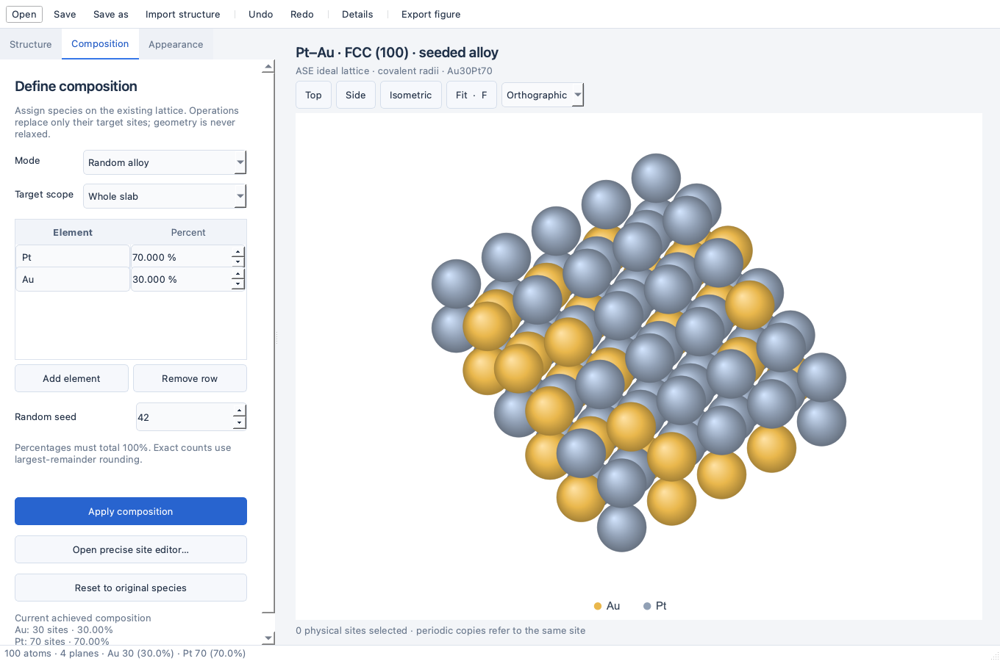
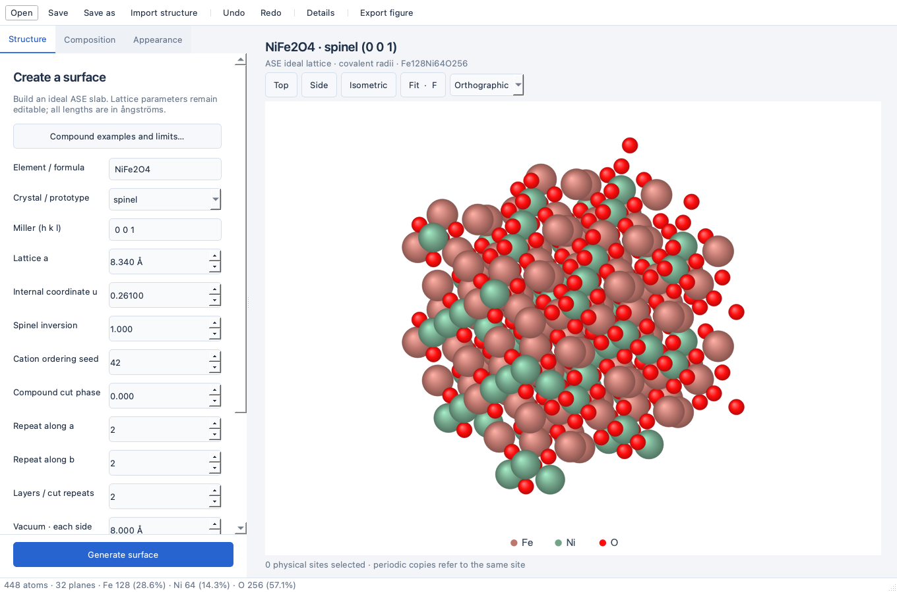

# Surfaces

Explore crystalline material surfaces and create scientific figures in a PySide6
desktop app built on [ASE](https://docs.ase-lib.org/). Build elemental slabs,
assign alloy compositions, and construct compounds from explicit crystal prototypes.
Style the atoms and camera, then export PNG, TIFF, PDF, or SVG figures.

[Installation](#installation) · [Screenshots](#screenshots) ·
[Examples](#example-projects) · [Compound guide](docs/COMPOUNDS.md) ·
[Contributing](CONTRIBUTING.md)

## Features

- **Surface construction:** FCC, BCC, HCP, and generic three-index Miller cuts;
  editable lattice parameters, in-plane repetitions, thickness, and vacuum.
- **Composition editing:** single elements, reproducible random alloys, selected
  sites, and layer-by-layer assignments, with exact integer counts and undo/redo.
- **Compound models:** nine explicit prototypes and 14 searchable examples,
  including PtO and NiFe2O4. Spinel cation occupations and cut phases are editable.
- **Interactive views:** orthographic/perspective projection, orbit/pan/zoom,
  camera presets, atom picking, element colors/radii, and periodic display copies.
- **Scientific figures:** antialiased RGBA PNG/TIFF and vector PDF/SVG, configurable
  canvas dimensions, DPI, margins, background transparency, legends, and axes.
- **Reproducible projects:** versioned JSON saves geometry, site identities,
  construction provenance, realized species assignments, camera, and export presets.
  Import prepared structures through ASE.

## Installation

Use **Python 3.11 or newer** and a graphical desktop. Download or clone this
repository, open a terminal in its root folder, and create a virtual environment.
There are currently no prebuilt application installers or public PyPI release.

### macOS / Linux

```sh
python3 -m venv .venv
.venv/bin/python -m pip install -e .
.venv/bin/python run_app.py
```

### Windows PowerShell

```powershell
py -3 -m venv .venv
.venv\Scripts\python.exe -m pip install -e .
.venv\Scripts\python.exe run_app.py
```

These commands use the virtual environment directly; activation is optional.
The root launcher also works from another working directory when given its absolute
path. If the current Python is missing dependencies, it tries the checkout's local
`.venv`. Installing the package provides a `surfaces` console command as well.

Native use has been inspected on macOS. GitHub Actions is configured for headless
checks on Linux, macOS, and Windows; native Windows/Linux interaction and installers
have not yet been verified.

## Screenshots

### Seeded Pt–Au alloy

A reproducible 70% Pt / 30% Au surface, with composition controls and the shared
publication viewport.



### NiFe2O4 compound surface

An inverse-spinel model built from an explicit multi-species crystal basis, with
editable internal coordinate, cation occupation, and cut phase.



The screenshots show the real app using the committed example projects. They can
be regenerated with [the capture script](tools/capture_screenshots.py).

## First workflow

1. Start with the default Pt FCC (100) slab or edit the Structure recipe, then Generate.
2. In **Composition**, choose Random alloy, set percentages totaling 100%, choose
   a scope and seed, then Apply. For layered structures, click a layer's composition
   and choose one element or a mixture.
3. In **Appearance**, adjust element colors/radii, background, and annotations, then
   Update appearance. These settings do not change atomic coordinates.
4. Choose a view and Fit. Open **Export figure**, set format and dimensions, inspect
   its preview, and save. Save the project to reproduce the realized structure.

For compounds, open **Structure → Compound examples and limits…**, select a model,
choose **Use example**, inspect the parameters, and Generate. A compound requires a
formula **and** a crystal prototype; assigning oxide ratios on a metal lattice does
not construct an oxide phase.

## Example projects

Use **Open** in the app to load these files:

| Example | Project |
| --- | --- |
| Monometallic Pt FCC (100) | [pt100.surfaces.json](examples/pt100.surfaces.json) |
| Seeded Pt–Au random alloy | [pt-au-random.surfaces.json](examples/pt-au-random.surfaces.json) |
| Pt–Au layered surface | [pt-au-layered.surfaces.json](examples/pt-au-layered.surfaces.json) |
| Tetragonal PtO (001) | [pto001.surfaces.json](examples/pto001.surfaces.json) |
| Inverse-spinel NiFe2O4 (001) | [nife2o4-001-inverse.surfaces.json](examples/nife2o4-001-inverse.surfaces.json) |

See [Compound examples and limits](docs/COMPOUNDS.md) for the complete catalog,
formula syntax, prototype conventions, starting parameters, and termination rules.

## Navigation

Drag to orbit; Shift-drag or middle-drag to pan; scroll to zoom. Click to select an
atom; Ctrl/⌘-click adds or removes sites. `F` fits and Escape clears selection.
Save/Open/Undo/Redo use standard platform shortcuts; Export uses Ctrl+E. The site
editor supports row selection and element assignment by double-clicking a species.
Periodic display copies refer to the same physical sites and do not add atoms to
composition counts.

## Scientific conventions and limits

- Distances are in ångströms. Default sizes use **ASE covalent radii**, with explicit
  per-element overrides and a separate display scale. They are not exact metallic
  or oxidation-state-dependent ionic sizes.
- Structures are ideal, unrelaxed geometry models. Species substitutions do not
  optimize a structure, predict alloy equilibrium, or validate charge balance.
  Compounds do not infer a phase from a formula or assess surface stability,
  polarity, reconstruction, magnetism, or fractional occupancies.
- Specialized surface builders count atomic planes. Generic and compound cuts count
  complete oriented bulk-cell repeats; inspect actual plane counts in Details.
  Miller indices refer to the stated bulk cell. HCP/wurtzite use three indices,
  not four-index Miller–Bravais notation.
- Spinel ordering is explicit within one 56-atom conventional cell, then repeated
  periodically. Inversion is realized in steps of 1/8; requested and achieved
  values are recorded. This is a finite ordering model, not macroscopic disorder.
- Projects preserve geometry/species and app settings, not simulation calculators,
  constraints, or arbitrary imported ASE arrays. Imports use the last frame and
  omit simulation constraints. Regeneration creates new IDs; undo restores old IDs.
- Rendering uses depth-sorted vector spheres, with approximate overlap occlusion
  and perspective projection. It does not show bonds, electron density, or ray-traced
  shadows. Text/strokes scale with figure width. Export retains camera pan/zoom;
  inspect the preview or Fit before saving.
- Transparent PDF means **no painted page background**, not an RGBA page. PDF viewers
  usually display paper as white. SVG/PDF retain vector atoms and annotations.

Guardrails are 20,000 physical atoms, 40,000 displayed atoms, 1–5 display copies per
in-plane direction, 24 megapixels and 20,000 pixels per raster side, and 30 undo
snapshots. These bound workloads rather than promise a particular frame rate.

## Development

Install development dependencies in the environment used above:

```sh
python -m pip install -e ".[dev]"
python -m ruff check .
python -m ruff format --check .
python -m pytest -q
```

Use the virtual environment's Python directly or activate it before these commands.
For a headless test session, set `QT_QPA_PLATFORM=offscreen`; see
[Contributing](CONTRIBUTING.md) for platform-specific commands and screenshot capture.
Tests cover scientific geometry, seeds/occupations, site identity, project round
trips, file validation, raster/vector exports, framing, and Qt workflows.

Further project notes: [coding guidance](AGENTS.md), [product](docs/PRODUCT.md),
[architecture](docs/ARCHITECTURE.md), [design](docs/DESIGN.md), and
[decisions](docs/DECISIONS.md).

## License

Surfaces is released under the [MIT License](LICENSE). Dependencies retain their
own licenses and are installed separately; their source and binaries are not
vendored in this repository.
