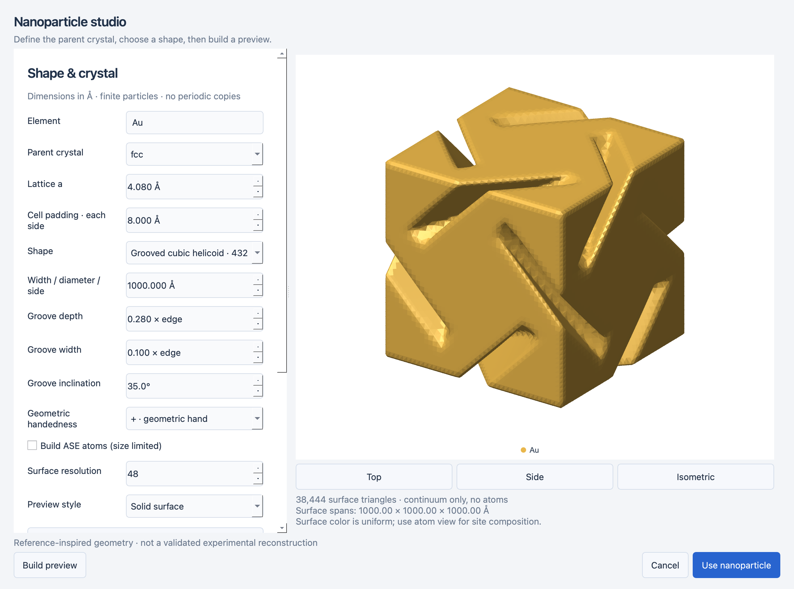
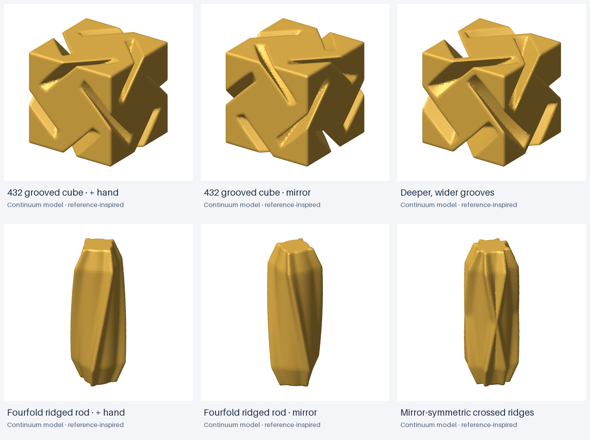

# Grooved cubic particles and fourfold ridged nanorods

Open **Structure → Nanoparticle studio…** and select either **Grooved cubic helicoid ·
432 model** or **Fourfold ridged chiral nanorod**. These are reference-inspired,
adjustable **geometric approximations**, not validated experimental reconstructions
or a simulation of ligand-directed growth. In particular, the cubic preset is not
claimed as a recovered CAD model of experimental Helicoid III.

## Controls and workflow

1. Select the shape and dimensions. Lengths are in Å: **1,000 Å = 100 nm**.
2. Set the groove or ridge controls and geometric handedness. The two signs define
   mirror partners; there is no automatic mapping to D/L cysteine or glutathione.
3. Choose whether to **Build ASE atoms**. Disable it for large continuum-only models.
   No coarse substitute atoms or estimated atom counts are silently introduced.
4. Build the preview. Inspect the surface and, if atoms were generated, switch
   Preview style between **Solid surface** and **ASE atoms**.
5. Use the particle. The normal Appearance panel switches representation; Save,
   Undo/Redo and figure export work with both. Site composition/picking require atoms.

The surface uses one material color, even after site substitutions. Switch to atom
view to inspect alloy assignments. Surface color is not a map of local composition.

## Grooved cubic envelope

The outer cube has edge length `width`, aligned with the conventional FCC cubic
axes. A seed groove is constructed along one edge and repeated with **all 24 proper
rotations of the cube**. This gives a 432-invariant envelope, without adding mirror
planes. The opposite geometric hand reverses the signed groove inclination.

In coordinates normalized by cube width, for a seed edge `x = y = 1/2`, define
`u = (x+y)/√2`, `v = (x-y)/√2`, and `t = z`. A groove removes points satisfying:

- `u ≥ 1/√2 − depth × max(0, 1 − (t/0.58)^4)`;
- `|v − hand × tan(angle) × (t + 0.5 t³)| ≤ gap_width/2`;
- `|t| ≤ 1/2`.

The full solid is the outer cube minus the union of rotated grooves. The odd center
line and even depth taper preserve the twofold rotation along a cube edge. Depth
and width are fractions of cube edge, not absolute nanometers. Inclination controls
the model's center line; it is **not** a calibrated experimental measurement angle.
The central volume stays intact. Meshing approximates the boundary at finite grid
resolution, so numerical surface triangles need not exhibit exact pointwise symmetry.

This equation is an explicit modeling choice informed by the observed morphology;
it is not copied from an experimental fitting model. Labels Helicoid I/II/III/V
should not be inferred from arbitrary parameter values.

## Fourfold ridged rod

The rod has an intact circular core and four smoothly peaked radial ridges. With
`z` normalized by length and `θ` the polar angle, ridge rotation is
`α(z) = hand × twist × z`. Twist is the total end-to-end rotation in degrees.

The radial envelope, before cap taper, is
`R(θ,z) = width/2 × [1 − height + height × exp(−(sin(2(θ−α−π/4))/ridge_width)²)]`.
Four equal peaks repeat around the core. Ridge prominence is a fraction of outer
radius; ridge width is the angular-profile parameter in radians. At each end, a
linear taper over `cap_fraction × length` reduces the outer radius by up to 30%,
then closes with a flat cap. This cap profile is a geometric choice, not a fitted
experimental end-facet construction.

The envelope has fourfold rotation about z and twofold transverse rotations (422).
The **crossed ridges** variant takes the union of the two mirrored ridge profiles,
producing a mirror-symmetric geometric comparison. It is not a prediction of the
morphology or composition of a racemic synthesis product.

All generated atoms remain on the parent FCC lattice: surface ridges arise by
selecting lattice sites inside the envelope, not by twisting the crystal coordinates.

## Representations, performance and limits

- These models use FCC with parent **[001]** along particle z. Unsupported parents
  receive a validation error. A geometric shape does not establish surface Miller
  indices or imply a single facet on a curved/grooved surface.
- Morphology width/length: 0.1–5,000 Å; rods require length ≥ width. At finite lattice
  resolution, very small shapes can contain few or no atoms and may poorly resolve
  the surface features. The surface itself is continuum geometry.
- Surface resolution: 32–80 samples per grid axis. Increasing it improves boundary
  detail and increases preview time, memory and vector-export size. Resolution is
  separate from physical size and lattice constant.
- Optional filling retains the existing 250,000-candidate/20,000-atom limits. Requests
  exceeding these limits fail with instructions to reduce size or disable atom filling.
- Continuum-only projects explicitly contain **zero generated atoms**, not a model
  with one proxy atom. Atom editing and atom representation are disabled.
- The bounding cell is nonperiodic with padding; geometry and surface share the same
  origin. Version **4** saves the mesh, recipe, material, coordinates and representation;
  versions 1–3 remain readable. Opening never remeshes or refills a structure.
- PDF/SVG contain vector triangles and text. PNG/TIFF render the same scene with
  requested dimensions and optional alpha. No widget screenshots are used for exports.
- Surface lighting approximates smooth normals on a finite mesh. Backface culling
  and triangle depth sorting approximate concave visibility; complex overlapping
  projections can have painter-order artifacts. Inspect final figures from the
  chosen camera. This is not an optical/material simulation or ray tracer.
- No relaxation, growth kinetics, ligand adsorption, optical chirality, strain field,
  or experimentally calibrated surface reconstruction is computed.

## References and reproduction

The cubic morphology is informed by the concave edge gaps and cubic symmetry
reported in [Choi et al., *Strain and crystallographic identification of the helically
concaved gap surfaces of chiral nanoparticles*](https://doi.org/10.1038/s41467-023-39255-1).
The rod is informed by the intact single-crystal seed and four tilted ridges reported
in [Ni et al., *Chiral Seeded Growth of Gold Nanorods Into Fourfold Twisted Nanoparticles
with Plasmonic Optical Activity*](https://doi.org/10.1002/adma.202208299).
These references motivate qualitative features; the app's equations above define
its actual models and are not asserted to reproduce those studies quantitatively.

Regenerate the actual studio screenshot and gallery with
`python tools/capture_morphologies.py`. The gallery is generated from the application's
surfaces, not edited from the reference illustrations.

