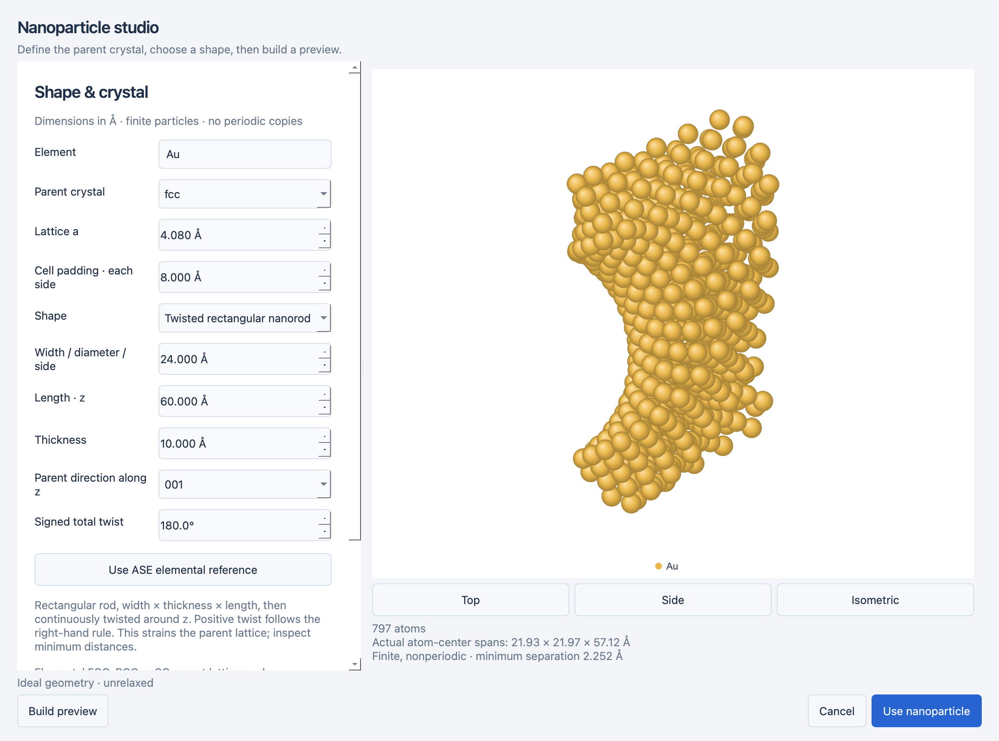
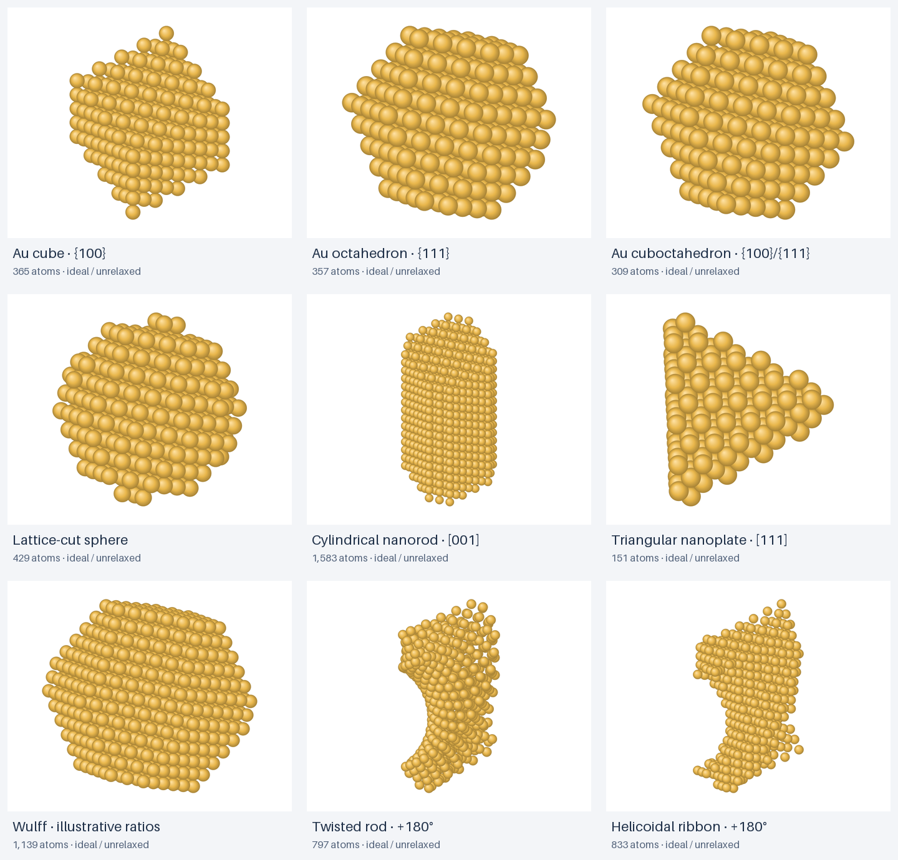

# Nanoparticles: shapes, facets and chiral constructions

Open **Structure → Nanoparticle studio…**. The studio builds a preview in a worker,
shows the actual atom count, atom-center spans and minimum interatomic separation,
and enables **Use nanoparticle** only after a successful build. Editing a recipe
requires rebuilding the preview. Top, Side and Isometric views support inspection.
Use the normal Composition, Appearance, Save, Undo/Redo and Export figure workflows
once the particle is in the workspace. Reopen the studio to edit its saved recipe.
The slab Generate button creates a new slab rather than modifying a particle.

## Shapes and conventions

Parent lattices are **elemental FCC, BCC and SC**, with explicit lattice constant
and source. Choose a matching ASE reference or supply a verified value. A formula
such as NiFe2O4 is rejected rather than replaced by a metal approximation. Existing
alloy operations can assign elements afterward, on the unchanged parent geometry.
Compound particles and twinned/decahedral/icosahedral particle models are not
implemented; prepared geometries can be imported through ASE.

| Construction | Inputs and meaning |
| --- | --- |
| Cube | ASE cluster bounded by the cubic **{100}** family. An FCC Au cube therefore exposes Au(100)-type faces. |
| Octahedron | ASE cluster bounded by **{111}**. |
| Cuboctahedron | FCC **{100}** squares and **{111}** triangles, with equal ASE layer counts for the two families. |
| Custom facet layers | One row per cubic family, with center-to-facet layer counts. ASE generates all symmetry equivalents. |
| Wulff | Facet families, supplied surface energies, target atom count and closest/above/below rounding. |
| Sphere | Diameter bounds a sphere cut from a parent lattice. |
| Ellipsoid | Full x/y/z diameters are width/thickness/length. |
| Cylindrical nanorod | Circular diameter and axial length. |
| Rectangular nanorod | Width × thickness cross section and axial length. With [001], faces belong to {100}. |
| Triangular nanoplate | Equilateral triangle side length and axial thickness; [111] gives {111} broad faces. No twin boundary is introduced. |
| Hexagonal nanoplate | Vertex-to-vertex diameter and axial thickness; [111] gives {111} broad faces. |
| Twisted rectangular nanorod | Deform a rectangular rod continuously about z. |
| Helicoidal ribbon | Cut an undeformed parent lattice using a rectangular cross section that rotates along z. |

`{100}` denotes a family of equivalent planes; `(100)` denotes one plane and `[001]`
a direction. Facet indices refer to the conventional cubic parent cell. Custom
families use reduced, nonnegative indices from 0 to 3, such as `1 0 0`, `1 1 1`
or `2 1 1`. Symmetry-equivalent duplicate rows are rejected. This editor does not
support independent cuts on individual members of the same family.

Facet layer counts run from the cluster center outward, using ASE's parent-lattice
plane spacing; they are **not** a total slab thickness or a diameter in ångströms.
Small discrete particles may not expose every supplied family. Whole atomic layers
also make the achieved Wulff atom count differ from the target. The preview and
Details record the achieved geometry and requested parameters.

Geometric envelopes use full dimensions in ångströms, not a target number of atoms.
They include atom centers at the boundary with numerical tolerance. Rendered radii
extend beyond that boundary; the measured spans can be smaller than the requested
envelope. Dimensions do not control an equilibrium shape.

For envelopes, choose parent [001], [110] or [111] along particle z. Particle x is
[100] for [001], or [1 −1 0] for the other axes; y completes a right-handed frame.
The matrix is recorded in provenance. Spheres, cylinders and curved boundaries
contain atomic terraces/steps, rather than one exact Miller facet. Rotated prisms
have the face normals defined by their frame; the UI only assigns named families
where the relationship is specified above.

## Wulff inputs

Supply positive surface energies in **J/m²**, **eV/Ų**, or dimensionless relative
ratios. All rows must use the same convention. Energies per atom are not appropriate.
Record the source and relevant environmental assumptions. The default 1.0 : 0.9
ratios are explicitly **illustrative**, not measured Au surface energies. Keep the
illustrative checkbox enabled unless replacing them with justified inputs.

ASE performs the construction using the supplied ratios; the application does not
calculate surface energies. Results do not establish a real equilibrium morphology
without suitable energies and assumptions. Species substitutions afterward do not
predict alloy segregation or recompute a Wulff shape. Extreme ratios above 20:1 are
outside this bounded builder. A requested atom count near the physical limit can
produce an above-limit result and must be reduced.

## Chiral geometry: two distinct models

Use a **signed total twist**, between −360° and +360°, to explore opposite handedness.
With centered particle z and requested axial length L, the convention is
`theta(z) = twist × z / L`. Positive angles follow the right-hand rule about +z;
changing the sign gives the mirror partner for a compatible symmetric parent cut.
Actual outermost atomic planes may span less than L. Width must exceed thickness
and the absolute twist must be at least 1° for these constructions.

- **Twisted rod:** rotate each retained atom's x/y coordinates by theta(z). This
  deforms and strains the parent lattice; global Miller facet labels no longer
  describe its curved sides. The preview reports minimum separation, and severe
  contacts below 55% of the parent nearest-neighbor distance are rejected. This
  threshold is a guard against gross overlaps, not proof of physical validity.
- **Helicoidal ribbon:** rotate the rectangular cutting envelope along z, retaining
  parent lattice sites inside it. Atomic positions are not twisted. The result
  approximates a solid helicoidal ribbon using discrete terraces and may have thin
  or poorly connected regions at coarse sizes. This is a geometric construction,
  not a model of experimentally synthesized chiral helicoid nanoparticles.

Neither model performs relaxation, growth simulation, chiral optical calculations,
or a crystallographic chirality classification. A signed twist parameter does not
by itself establish experimental chirality for every finite discretization. Inspect
both signs, atom counts and connectivity before using a model in a scientific claim.

## Limits, persistence and export

- At most **20,000 retained atoms** and **250,000 candidate lattice sites** per build;
  allocation guards run before candidate construction, including ASE Wulff trials.
- Facet-layer inputs: 1–30; up to 12 distinct families. Very large requests can reach
  the candidate or retained-atom limit even within these input ranges.
- Envelope dimensions: 0.1–500 Å. Empty cuts and unsupported combinations fail with
  actionable errors. FCC is required for the cuboctahedron preset.
- Particles have **no periodicity**. The bounding box has padding on all six sides;
  periodic display copies are disabled. Composition layers are Cartesian z planes
  of the particle, not concentric shells or facets.
- Version **3** projects store the recipe, energies/source/illustrative flag, parent
  frame, realized geometry, species and stable IDs. Versions 1 and 2 still load;
  opening never regenerates geometry. Saving upgrades to version 3.
- PNG/TIFF/PDF/SVG use the shared scene with physical dimensions and background
  options. Vector atom rendering is retained; sphere occlusion remains approximate.
- Annotations are a separate proposed feature; this extension does not implement them.

## Examples and reproduction

Open [Au {100} cube](../examples/au-cube.surfaces.json),
[twisted Au rod](../examples/au-twisted-rod.surfaces.json), or
[illustrative Wulff Au particle](../examples/au-wulff.surfaces.json).
The following gallery contains actual ASE geometries rendered by the shared figure
backend. Regenerate it, the studio screenshot and these examples with
`python tools/capture_particles.py` after installing the project.

Reference: [ASE cluster and Wulff documentation](https://docs.ase-lib.org/ase/cluster/cluster.html).
